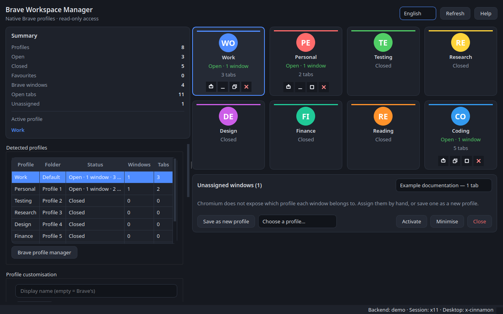
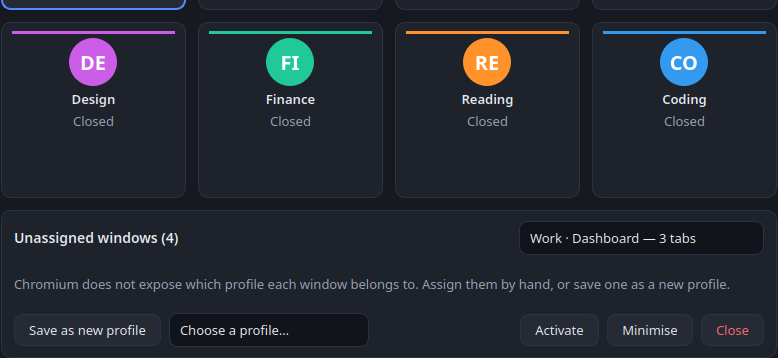

# Brave Workspace Manager


A manager for **native Brave profiles** on Linux Mint / Cinnamon.

It organises the profiles you already have in Brave (the ones listed in
`brave://settings/manageProfile`) from a single window: a gallery of profile
cards with window controls, global shortcuts, a system tray menu and
per-profile customisation (display name, colour, icon, image and favourite
mark) — **without ever modifying Brave's internal data**.

The interface is available in English and Spanish, and new languages can be
added with a single JSON file.



---

## Contents

- [Security guarantees](#security-guarantees)
- [Features](#features)
- [Requirements](#requirements)
- [Installation](#installation)
- [Usage](#usage)
- [How each window is matched to its profile](#how-each-window-is-matched-to-its-profile)
- [How open tabs are counted](#how-open-tabs-are-counted)
- [Keyboard shortcuts](#keyboard-shortcuts)
- [Languages](#languages)
- [Where data is stored](#where-data-is-stored)
- [Project structure](#project-structure)
- [Development and tests](#development-and-tests)
- [License](#license)

---

## Security guarantees

The application **only reads** Brave's data directory:

- It never modifies `Local State` or any internal database of the profiles.
- It never reads, copies or decrypts cookies, passwords, tokens, history,
  sessions or URLs.
- It does not intercept HTTPS traffic and does not install certificates.
- It opens profiles only with `--profile-directory=<folder>` on the single
  Brave instance, so it never starts parallel instances over the same profile.
- It does not change Brave's configuration. Creating and renaming profiles in
  Brave is left to Brave's own profile manager
  (`brave://settings/manageProfile`); the app stores its own display names in
  its own database.
- Everything the app saves (its preferences, learned window assignments,
  custom profile images) lives in `~/.local/share/brave-workspace-manager/`.
  Custom images are **copied** there; Brave's files are never touched.
- Closing a window from the app is a polite request (`WM_DELETE_WINDOW`, or
  `wmctrl -c`), the same as clicking the window's close button. No process is
  ever killed.

The only thing read from outside the app's own directory, apart from the
profile list, is the **tab titles** that the browser publishes through the
AT-SPI accessibility tree when it runs in accessibility mode (the app adds
`--force-renderer-accessibility` when it opens a profile). The titles are read
locally, kept in memory only, and never stored or sent anywhere.

## Features

- **Discovers** Brave's native profiles by reading `Local State` and the
  profile folders of the data directory. Read-only.
- **Profile gallery**: a responsive grid of cards, centred on the right side
  of the window, that rearranges itself to the window width. Each card shows
  the profile's avatar or custom image, colour, name, open/closed status,
  favourite mark and, for open profiles, the number of windows and tabs.
- **Window controls on each card**: icon buttons to activate, minimise /
  restore, maximise / restore and close the profile's window. When a profile
  has several windows, a **"…"** menu lists them with per-window actions.
  Closed profiles show no action buttons.
- **Activates a profile** with one click: brings its window to the front if
  the app knows it, or opens the profile in its native folder
  (`--profile-directory=Default`) otherwise.
- **Drag and drop** cards to reorder them; the order is saved.
- **Unassigned windows card**: the last card of the gallery collects the Brave
  windows that cannot be attributed automatically. Pick a window and assign it
  to an existing profile, save it as a new profile, or activate, minimise or
  close it.
- **Counts open tabs** per window and per profile; the card's tooltip lists
  the tab titles.
- **Learns** the window-to-profile mapping as you use it, so assignments are
  repeated each time profiles are launched from the app.
- **Customises** each profile with a display name, colour, icon, custom image
  and favourite mark.
- **Global shortcuts** (`Ctrl+Alt+1`…`9`, `Ctrl+Alt+Tab`,
  `Ctrl+Alt+Shift+Tab`).
- **System tray icon**, always present: a click (left or right) opens a menu
  with the open profiles first (avatar, tab count, the active one marked) and
  the closed ones under **Other profiles**; choosing one brings it to the
  front or opens it. A double click opens the window maximised. Closing the
  window hides it to the tray; **Quit** in the menu ends the app.
- **Bilingual interface** (English and Spanish) with a live language selector.
- **Installable** as a desktop application (`packaging/*.desktop`), a systemd
  user service, and with an autostart entry.

## Requirements

| Requirement | Details |
|---|---|
| System | Linux with an **X11** session (tested on Linux Mint 22.3 / Cinnamon) |
| Browser | Brave installed (`brave-browser` on the `PATH` or `/opt/brave.com/brave/brave`) |
| Python | 3.10 or later |
| Dependencies | `PySide6` (interface) and `python-xlib` (X11 protocol, no system dependencies) |
| Optional | `python3-gi` (PyGObject) to read tabs through AT-SPI; without it the app works the same but only shows the active tab |

> On Wayland, window management is not reliably possible, so the application
> runs in degraded mode: it discovers and opens profiles, but cannot list or
> activate windows. The status bar shows the active backend (`x11`, `wmctrl`
> or `none`).

## Installation

```bash
git clone https://github.com/jaaparenas/brave-workspace-manager.git
cd brave-workspace-manager
./setup.sh
```

`setup.sh` creates a virtual environment in `.venv`, installs the
dependencies and generates the `brave-workspace-manager` launcher in
`~/.local/bin`.

Manual installation, if you prefer not to use the script:

```bash
python3 -m venv .venv
.venv/bin/pip install -r requirements.txt
.venv/bin/python -m brave_workspace_manager
```

## Usage

```bash
./run.sh                                             # start the application
brave-workspace-manager                              # if installed with setup.sh
brave-workspace-manager --minimized                  # start hidden in the system tray
brave-workspace-manager --user-data-dir /other/path  # another Brave data directory
brave-workspace-manager --language es                # interface language
brave-workspace-manager --version
```

The main window has a header and two columns:

- **Header**: language selector, **Refresh** and **Help**.
- **Left column**, always visible:
  - **Summary**: number of profiles, open, closed and favourite profiles,
    Brave windows detected, open tabs, unassigned windows and the active
    profile.
  - **Administration panel**: the table of detected profiles, profile
    customisation (name, colour, icon, image, favourite, order, open, reset,
    and a button for Brave's own profile manager), settings (refresh
    interval, activate on click, global shortcuts, start
    with the system, list open tabs) and the shortcut editor.
- **Right column**: the **profile gallery**. A click selects (and, by
  default, activates) a profile, a double click opens it, and the context menu
  gives quick actions: activate, open, take the active window, rename, change
  colour, icon or image, favourite, move up/down and reset. Drag a card to
  reorder. The last card is **Unassigned windows**.



### Custom profile images

Choose an image with **Choose image…** in the administration panel or
**Change image…** in a card's context menu, and remove it with **Remove
image**. Supported formats: PNG, JPG/JPEG, WebP, BMP and GIF. The file is
copied to `~/.local/share/brave-workspace-manager/images/`, so the original
can be moved or deleted afterwards.

### Virtual profiles

**Save as new profile** on the Unassigned windows card creates a *virtual*
profile: a profile that exists only inside the app and owns that window. It
can be customised, reordered and used to activate its window like any other
profile, but it cannot be launched directly because it has no Brave profile
folder behind it.

## How each window is matched to its profile

This is the most delicate technical part of the project, so it is worth
explaining honestly.

**Chromium does not expose which profile each window belongs to.** There is
no X11 property, environment variable or file on disk that says so: all
windows of all profiles in the same `user-data-dir` share a single browser
process, so a window's PID does not identify its profile. The app does not
guess: it applies a cascade of rules, from most to least reliable, and
**reports the confidence with which it resolved each case**.

| Order | Rule | Confidence | How it works |
|---|---|---|---|
| 0 | Accessibility tree | 100 % | Brave publishes the profile name of each window (see [How open tabs are counted](#how-open-tabs-are-counted)). It beats every rule below except a manual assignment. |
| 1 | Learned assignment | 100 % | Stored in the local database when the app launches a profile or when the user assigns a window by hand. |
| 2 | Single open profile | 90 % | If only one profile is open, every Brave window belongs to it. |
| 3 | Elimination | 50 % | If exactly one window is unassigned and exactly one open profile has no windows, they belong together. |
| 4 | Unassigned | 0 % | Shown on the **Unassigned windows** card for you to resolve. |

**Open** profiles, on the other hand, are detected reliably: the browser
process keeps files open inside the profile folder, and its file descriptors
(`/proc/<pid>/fd`) are inspected.

The window title is **not** used: it is the title of the active page, and a
page can mention any profile name (a chat about "Work" may be open in another
profile). Guesses are never saved; only launches and manual assignments are.

If a window ends up on the wrong card, open the card's **…** menu and use
**Move to profile** or **Not from this profile**.

Learned assignments are kept per browser PID and window id, so they are reused
in later sessions.

## How open tabs are counted

Chromium does not expose through X11/EWMH how many tabs a window has: that
protocol only gives the window title, which is the title of the active tab.
The only local route that does not touch the browser's data is the
**accessibility tree** (AT-SPI), the same one screen readers use.

- The app runs `brave_workspace_manager/a11y_helper.py` in a separate process
  (the virtual environment may not have PyGObject) and receives JSON with the
  windows and their tabs.
- Chromium only publishes its interface, including the tab strip, when an
  assistive technology is present. The launcher adds
  `--force-renderer-accessibility` to the profiles the app opens. When Brave
  was started some other way, the app notices windows without tabs and turns
  on the `ScreenReaderEnabled` property of the accessibility bus for about
  12 seconds: Brave reacts by building its tree, keeps it afterwards, and the
  property goes back to its previous value. No GNOME setting changes and no
  screen reader starts. This is tried at most once every 5 minutes.
- When several profiles exist, Brave adds the **profile name** to the
  accessible name of each window (`Dashboard - Brave – Alice Doe`). The
  app uses it to know, with certainty, which profile owns each window.
- Each card shows the number of tabs; its tooltip lists the titles.
- The summary counts the open tabs of all profiles.

Only tab **titles** are read, and only in memory: they are never written to
disk or sent anywhere. The **List the open tabs** setting turns reading off
and stops adding the flag to the browser.

## Keyboard shortcuts

| Shortcut | Action |
|---|---|
| `Ctrl+Alt+1` … `Ctrl+Alt+9` | Activate profile N (gallery order) |
| `Ctrl+Alt+Tab` | Next profile |
| `Ctrl+Alt+Shift+Tab` | Previous profile |

All of them can be changed in the administration panel. Global shortcuts are
registered as passive keyboard grabs on the X11 root window; if another
application already uses a combination, the app reports it and disables that
shortcut instead of failing.

## Languages

The interface ships in **English** (fallback) and **Spanish**. On the first
start it follows the system language when a catalogue exists for it.
Switch language with the selector in the header; the change applies
immediately and is remembered. You can also start with
`--language es`.

### Adding a language

Translations are flat JSON catalogues in
`brave_workspace_manager/locales/`, one file per language, mapping keys to
texts. Placeholders use Python `str.format` syntax (`{name}`, `{count}`).

1. Copy `en.json` to `<code>.json` (for example `fr.json` or `pt.json`).
2. Translate the values. Keep the keys and the `{placeholders}` unchanged.
3. Set `"language_name"` to the language's own name (for example
   `"Français"`).
4. Run the tests: `tests/test_i18n.py` checks that every catalogue has exactly
   the same keys as `en.json` and no empty texts.

The new language appears in the selector automatically; no code changes are
needed. Missing keys fall back to English.

## Where data is stored

| What | Where |
|---|---|
| Local database (SQLite) | `~/.local/share/brave-workspace-manager/workspace.db` |
| Custom profile images | `~/.local/share/brave-workspace-manager/images/` |
| Log | `~/.local/state/brave-workspace-manager/` |
| Configuration | `~/.config/brave-workspace-manager/` |
| Autostart | `~/.config/autostart/brave-workspace-manager.desktop` |

All of the above can be deleted without touching Brave's data. The database
schema is migrated automatically when a new version adds columns.

## Project structure

```
brave_workspace_manager/
├── config.py            paths, desktop detection, Brave binaries
├── models.py            profiles, windows and matching methods
├── discovery.py         reading Local State and profile folders
├── processes.py         /proc inspection and open profiles
├── database.py          SQLite persistence and migrations
├── i18n.py              translation layer
├── locales/             en.json, es.json
├── a11y_helper.py       tab reading through AT-SPI (standalone script)
├── tabs.py              helper client and matching with windows
├── core/
│   ├── controller.py    application state and actions
│   ├── resolver.py      window -> profile rule cascade
│   ├── launcher.py      opening profiles with their native folder
│   └── autostart.py     autostart .desktop file
├── x11/
│   ├── backend.py       EWMH protocol with python-xlib
│   ├── wmctrl_backend.py  fallback through the wmctrl CLI
│   ├── grab.py          keyboard grabs for global shortcuts
│   └── base.py          common backend interface
└── ui/                  PySide6 interface (gallery, cards, admin panel, tray, theme)
```

More detail in [docs/ARCHITECTURE.md](docs/ARCHITECTURE.md), and the original
requirements in [docs/SPECIFICATION.md](docs/SPECIFICATION.md).

## Development and tests

```bash
QT_QPA_PLATFORM=offscreen .venv/bin/python -m pytest -q   # 144 tests, no browser needed
QT_QPA_PLATFORM=offscreen .venv/bin/python -m pytest --cov=brave_workspace_manager
ruff check
ruff format --check
```

The tests never touch real Brave data: they build a synthetic data directory
in a temporary folder.

Regenerate the documentation screenshots (synthetic data only):

```bash
.venv/bin/python tools/screenshot.py
```

It writes `docs/images/main-window.png`, `docs/images/main-window-es.png` and
`docs/images/unassigned-card.png`.

See [CONTRIBUTING.md](CONTRIBUTING.md) before sending a change.

## License

MIT. See [LICENSE](LICENSE).
